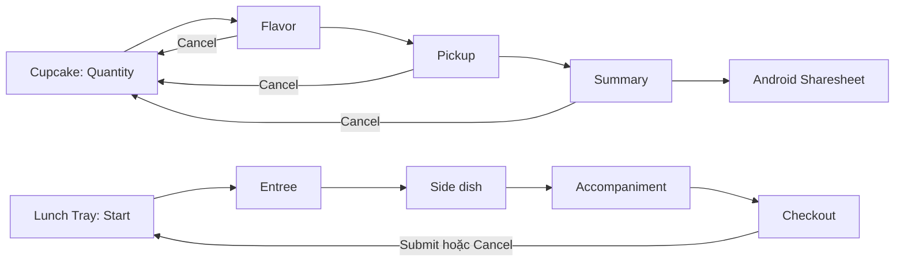

# Buổi 7 — Điều hướng trong Jetpack Compose

Nguyễn Như Vũ · 25610008

[Lộ trình](https://developer.android.com/courses/pathways/android-basics-compose-unit-4-pathway-2?hl=vi)

| Codelab | Module / kết quả |
|---|---|
| [Navigate between screens](https://developer.android.com/codelabs/basic-android-kotlin-compose-navigation) | `cupcake`: chọn số bánh → hương vị → ngày lấy → tóm tắt; chia sẻ đơn bằng ACTION_SEND |
| [Test Cupcake](https://developer.android.com/codelabs/basic-android-kotlin-compose-test-cupcake) | TestNavHostController, kiểm tra route, Back/Up, Cancel, kiểm tra màn hình chọn lượng/ngày và tổng tiền |
| [Practice Navigation](https://developer.android.com/codelabs/basic-android-kotlin-compose-practice-navigation) | `lunchtray`: Start → Entree → SideDish → Accompaniment → Checkout; Submit/Cancel quay về Start và reset đơn |

## Luồng và mã cần xem



- `CupcakeScreen.kt` / `LunchTrayScreen.kt`: enum route, NavHost, NavController, AppBar đổi tiêu đề theo back stack và nút Up.
- `OrderViewModel.kt`: một nguồn trạng thái, lựa chọn được chia sẻ giữa các màn hình. Cupcake 2 đơn vị tiền/bánh, thêm 3 nếu lấy cùng ngày. Lunch Tray cộng từng loại món và thuế 8%.
- `cupcake/src/androidTest/`: các bài kiểm thử được yêu cầu trong codelab; giữ các helper kiểm tra route/nội dung.
- Bổ sung unit test tính tiền và reset đơn; LunchNavigationTest kiểm tra luồng hoàn thành, Cancel và Up.

Chọn **cupcake** hoặc **lunchtray** để chạy. Thử đủ bốn/bốn bước đặt hàng, Up, Cancel, chọn lại món, xoay màn hình; riêng Cupcake kiểm tra Android Sharesheet (không tự gửi đơn tới người nhận). Đây là ứng dụng học tập, không đặt hàng hoặc thanh toán thật.

State trong ViewModel giữ qua xoay màn hình; không có database hoặc cam kết khôi phục đơn sau force-stop/process death. Tiền được định dạng theo locale thiết bị như bài mẫu.

## Chạy trong Android Studio

Mở trực tiếp thư mục buổi học chứa `settings.gradle.kts`, chờ Gradle Sync, chọn module và chọn điện thoại/máy ảo rồi nhấn Run. Mỗi buổi là project độc lập; không mở thư mục gốc của repo như một project Android duy nhất. Các applicationId khác nhau nên có thể cài các buổi song song.

Build và kiểm thử tại thư mục buổi học:

```powershell
.\gradlew.bat assembleDebug testDebugUnitTest assembleDebugAndroidTest
```

Chạy kiểm thử giao diện khi đã kết nối thiết bị:

```powershell
.\gradlew.bat connectedDebugAndroidTest
```

Dùng SDK 37, minSdk 24, Gradle 9.6.0, AGP 9.4.1, Compose Compiler 2.2.10 và Gradle daemon JDK 25, thống nhất với cấu hình các buổi trước. Máy Android chỉ cần API 24 trở lên. Gradle wrapper đã kèm theo; `local.properties` và build/cache không đưa lên Git.

## Nguồn và phạm vi

Mã/tài nguyên Android dựa trên mẫu chính thức của Google, giữ copyright và giấy phép Apache 2.0 trong `LICENSE`. Commit nguồn và các repo tham khảo nằm ở `SOURCES.md`. Bài nộp điều chỉnh build cho môi trường hiện tại, tổ chức theo buổi, bổ sung kiểm thử và hướng dẫn. Video/quiz trên tài khoản khóa học do sinh viên tự hoàn thành; repo không đánh dấu thay tiến độ hoặc huy hiệu trên website.

Kết quả kiểm tra thực tế: xem `VALIDATION.txt`. Biên dịch APK kiểm thử không đồng nghĩa với đã chạy kiểm thử trên thiết bị.
