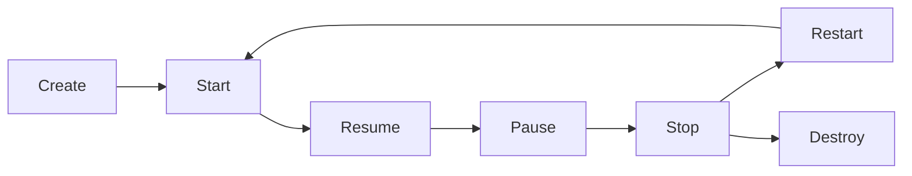

# Buổi 8 — Vòng đời Activity: Dessert Clicker

Nguyễn Như Vũ · 25610008

[Codelab được giao](https://developer.android.com/codelabs/basic-android-kotlin-compose-activity-lifecycle?hl=vi)

Module **dessertclicker** triển khai phần kết thúc bài:

- Nhấn món bánh để tăng số lượng và doanh thu; đổi ảnh/giá ở các mốc sản xuất.
- Ghi Log.d với tag `MainActivity` tại onCreate, onStart, onResume, onPause, onStop, onDestroy và onRestart.
- Các biến trạng thái dùng `rememberSaveable` để giữ số bánh, doanh thu và món hiện tại khi Activity được tạo lại.
- Nút Share mở Android Sharesheet với số bánh/doanh thu.
- Có unit test các ngưỡng đổi bánh và instrumentation test nhấn 5 lần, recreate Activity, tiếp tục nhấn lần 6.

## Thực hành Logcat

1. Mở app, lọc Logcat theo package `com.nhuvu25610008.buoi8.dessertclicker` và tag `MainActivity`. Quan sát Create → Start → Resume.
2. Nhấn bánh 5 lần: số bánh 5, doanh thu 25, ảnh chuyển sang donut. Giá donut áp dụng từ lần nhấn thứ 6, doanh thu lúc đó 35.
3. Nhấn Home rồi quay lại: quan sát Pause/Stop và Restart/Start/Resume.
4. Xoay màn hình: quan sát chuỗi hủy/tạo lại Activity; số bánh và doanh thu vẫn giữ.
5. Nhấn Back rồi mở lại: quan sát một phiên Activity mới. Không xem rememberSaveable là lưu database lâu dài; force-stop hoặc loại bỏ task không có bảo đảm giữ phiên.



Đối chiếu với `../buoi9/dessertviewmodel`: buổi 8 giữ trạng thái tại composable, buổi 9 đưa trạng thái và logic sang ViewModel.

## Chạy trong Android Studio

Mở trực tiếp thư mục buổi học chứa `settings.gradle.kts`, chờ Gradle Sync, chọn module và chọn điện thoại/máy ảo rồi nhấn Run. Mỗi buổi là project độc lập; không mở thư mục gốc của repo như một project Android duy nhất. Các applicationId khác nhau nên có thể cài các buổi song song.

Build và kiểm thử tại thư mục buổi học:

```powershell
.\gradlew.bat assembleDebug testDebugUnitTest assembleDebugAndroidTest
```

Chạy kiểm thử giao diện khi đã kết nối thiết bị:

```powershell
.\gradlew.bat connectedDebugAndroidTest
```

Dùng SDK 37, minSdk 24, Gradle 9.6.0, AGP 9.4.1, Compose Compiler 2.2.10 và Gradle daemon JDK 25, thống nhất với cấu hình các buổi trước. Máy Android chỉ cần API 24 trở lên. Gradle wrapper đã kèm theo; `local.properties` và build/cache không đưa lên Git.

## Nguồn và phạm vi

Mã/tài nguyên Android dựa trên mẫu chính thức của Google, giữ copyright và giấy phép Apache 2.0 trong `LICENSE`. Commit nguồn và các repo tham khảo nằm ở `SOURCES.md`. Bài nộp điều chỉnh build cho môi trường hiện tại, tổ chức theo buổi, bổ sung kiểm thử và hướng dẫn. Video/quiz trên tài khoản khóa học do sinh viên tự hoàn thành; repo không đánh dấu thay tiến độ hoặc huy hiệu trên website.

Kết quả kiểm tra thực tế: xem `VALIDATION.txt`. Biên dịch APK kiểm thử không đồng nghĩa với đã chạy kiểm thử trên thiết bị.
