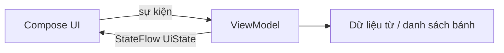

# Buổi 9 — Architecture Components, ViewModel và StateFlow

Nguyễn Như Vũ · 25610008

[Lộ trình được giao](https://developer.android.com/courses/pathways/android-basics-compose-unit-4-pathway-1?hl=vi)

| Nội dung trong lộ trình | Bài thực hành |
|---|---|
| Activity Lifecycle | Đã làm riêng theo yêu cầu ở [buổi 8](../buoi8/README.md) |
| [ViewModel and State](https://developer.android.com/codelabs/basic-android-kotlin-compose-viewmodel-and-state) | `unscramble`: GameUiState, GameViewModel, StateFlow và luồng dữ liệu một chiều |
| [Test ViewModel](https://developer.android.com/codelabs/basic-android-kotlin-compose-test-viewmodel) | Giữ 5 unit test mẫu: khởi tạo, sai, đúng, bỏ qua, kết thúc; thêm test chơi lại và không cộng điểm sau game over |
| [Practice ViewModel](https://developer.android.com/codelabs/basic-android-kotlin-compose-practice-viewmodel) | `dessertviewmodel`: DessertUiState + DessertViewModel chứa doanh thu, số lượng, món hiện tại và xử lý bán bánh |

## Chạy và quan sát

**Unscramble**: nhập từ gốc của từ bị xáo trộn, nhấn Submit; đúng được cộng điểm và sang từ mới, sai hiện lỗi; Skip không cộng điểm. Sau 10 từ có hộp thoại kết thúc, Play Again đặt lại toàn bộ lượt chơi. Xoay màn hình vẫn giữ tiến độ nhờ ViewModel. Danh sách từ tiếng Anh giữ theo bài mẫu.

**Dessert ViewModel**: nhấn ảnh bánh để tăng doanh thu, xoay màn hình rồi tiếp tục. `DessertViewModel.sellDessert()` cộng giá món hiện tại trước khi chọn món tiếp theo. Composable chỉ đọc trạng thái và phát sự kiện; không dùng rememberSaveable để quản lý logic bán hàng như buổi 8.



ViewModel giữ trạng thái qua thay đổi cấu hình, không tự lưu database hoặc khôi phục sau process death. Bản Dessert ViewModel dùng lại layout/tài nguyên mẫu lifecycle, nhưng lớp trạng thái và ViewModel được bổ sung cho bài thực hành. Unscramble giữ test và nguồn mẫu Google; bổ sung chặn thao tác sau game over và reset ô nhập khi chơi lại.

## Chạy trong Android Studio

Mở trực tiếp thư mục buổi học chứa `settings.gradle.kts`, chờ Gradle Sync, chọn module và chọn điện thoại/máy ảo rồi nhấn Run. Mỗi buổi là project độc lập; không mở thư mục gốc của repo như một project Android duy nhất. Các applicationId khác nhau nên có thể cài các buổi song song.

Build và kiểm thử tại thư mục buổi học:

```powershell
.\gradlew.bat assembleDebug testDebugUnitTest assembleDebugAndroidTest
```

Chạy kiểm thử giao diện khi đã kết nối thiết bị:

```powershell
.\gradlew.bat connectedDebugAndroidTest
```

Dùng SDK 37, minSdk 24, Gradle 9.6.0, AGP 9.4.1, Compose Compiler 2.2.10 và Gradle daemon JDK 25, thống nhất với cấu hình các buổi trước. Máy Android chỉ cần API 24 trở lên. Gradle wrapper đã kèm theo; `local.properties` và build/cache không đưa lên Git.

## Nguồn và phạm vi

Mã/tài nguyên Android dựa trên mẫu chính thức của Google, giữ copyright và giấy phép Apache 2.0 trong `LICENSE`. Commit nguồn và các repo tham khảo nằm ở `SOURCES.md`. Bài nộp điều chỉnh build cho môi trường hiện tại, tổ chức theo buổi, bổ sung kiểm thử và hướng dẫn. Video/quiz trên tài khoản khóa học do sinh viên tự hoàn thành; repo không đánh dấu thay tiến độ hoặc huy hiệu trên website.

Kết quả kiểm tra thực tế: xem `VALIDATION.txt`. Biên dịch APK kiểm thử không đồng nghĩa với đã chạy kiểm thử trên thiết bị.
